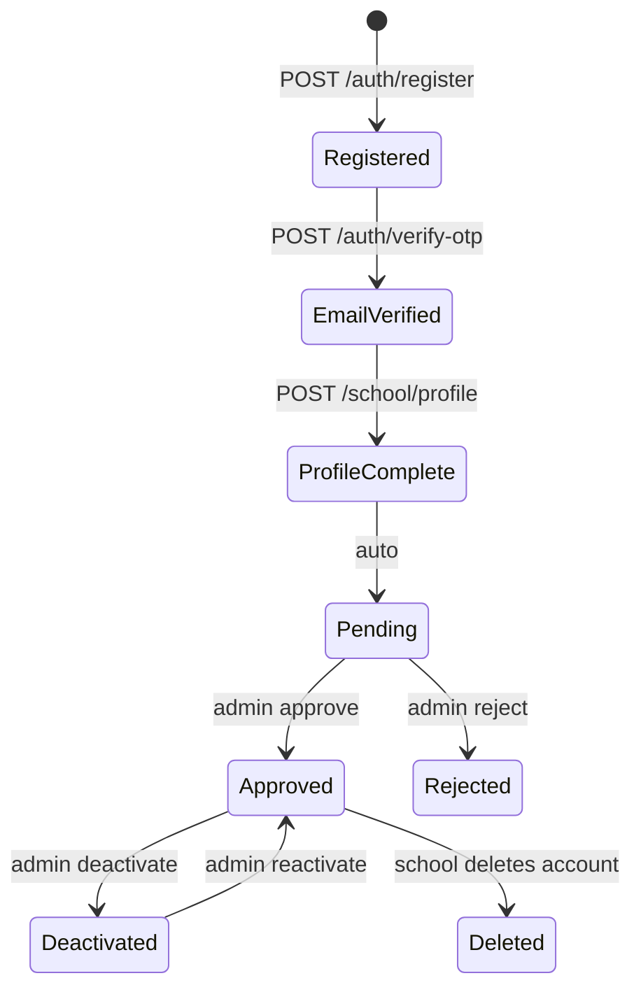

# 02 — Laravel Architecture

## 1. Stack

| Concern | Choice | Notes |
|---|---|---|
| Framework | Latest stable **Laravel** (PHP 8.3+) | API-only. No Blade UI |
| Database | **PostgreSQL** (MySQL 8 also fine) | Needs transactions and row locks (`SELECT … FOR UPDATE`) |
| Cache / queue | **Redis** + **Laravel Horizon** | Webhooks and payouts run on queues |
| Auth | **Laravel Sanctum** | Bearer tokens (two separate SPAs on other origins). Token abilities `admin` / `school` |
| Authorization | Policies + a `role` enum on `users` | Only two roles. `spatie/laravel-permission` is overkill |
| Files | S3-compatible disk (private bucket) | Avatars (public via CDN), ticket attachments (private, signed URLs) |
| Mail | SMTP/SES via Laravel Mail | OTP, approval and payout mails |
| Stripe | `stripe/stripe-php` | Connect transfers, onboarding links |
| Shopify | Laravel `Http` client + a thin `ShopifyClient` | Custom app installed on the store. No heavy SDK |
| Audit | `spatie/laravel-activitylog` | Who approved, who paid out, who changed the rate |
| Money | `brick/money` (or integer helper) | Integer minor units + currency |
| Testing | **Pest** + `Http::fake()` + Stripe mock | See 07 |
| Static analysis | Larastan (level 6+), Pint | CI |
| API docs | `dedoc/scramble` (generates OpenAPI from code) | Keeps 05 honest |
| Social login (optional, D6) | Laravel Socialite | Google/Apple |

## 2. Shape of the app

A **modular monolith**. One Laravel app, grouped by domain.

```text
app/
  Domain/
    Auth/            # OTP, registration, password reset
    Schools/         # School model, approval, profile, public listing
    Donations/       # RateVersion, Allocation, Ledger, calculator
    Orders/          # ShopifyOrder, items, ingestion, status mapping
    Payouts/         # Transfers, withdrawals, balance service, Stripe Connect engine
    Support/         # Tickets, messages, attachments
    Notifications/   # Notification types + channels
    Content/         # CMS pages: About, Terms, Privacy
    Reporting/       # Dashboard queries, CSV exports
  Integrations/
    Shopify/         # ShopifyClient, HMAC verifier, webhook handlers, payload normalizer
    Stripe/          # StripeClient wrapper, webhook handlers, ConnectOnboarding
  Http/
    Controllers/Api/V1/{Admin,School,Storefront,Auth}/
    Controllers/Webhooks/
    Requests/        # FormRequests, one per write endpoint
    Resources/       # API Resources, one per response shape
    Middleware/      # EnsureRole, EnsureSchoolApproved, VerifyShopifyHmac, VerifyStripeSignature
  Jobs/              # ProcessShopifyWebhook, CreateDonationAllocation, ExecuteTransfer, ExecuteWithdrawal, ...
```

Conventions:

- **Controllers are thin.** They call one **Action** class (`ApproveSchool`, `CreatePayout`) and return a Resource.
- **Actions own transactions.** Anything that touches money runs in `DB::transaction()` and locks the rows it reads.
- **Policies** gate every admin and school route. Schools can only ever see their own `school_id`, resolved from the token, never from the request.
- **Enums** for every status (`SchoolStatus`, `OrderStatus`, `AllocationStatus`, `PayoutStatus`, `TicketStatus`).
- **Events + listeners** fan out notifications (`SchoolApproved` → mail + in-app notification).
- **Integers only** for money. Columns are `*_minor` (`bigInteger`). A `Money` cast converts at the edge.

## 3. Routing and versioning

- Prefix: `/api/v1`.
- Areas: `/auth/*`, `/admin/*`, `/school/*`, `/storefront/*` (public), `/webhooks/*`.
- Admin and school share paths for common features (tickets, notifications, password) but live under their own prefix. The role is part of the route group, which keeps authorization obvious.
- Responses use a consistent envelope:

```json
{ "data": { }, "meta": { "page": 1, "per_page": 15, "total": 120 } }
```

```json
{ "message": "The given data was invalid.", "code": "validation_failed", "errors": { "email": ["…"] } }
```

- Pagination: `?page=&per_page=`. Search: `?search=`. Filters: `?status=&date_from=&date_to=`. Sorting: `?sort=-created_at`.

## 4. Authentication & account lifecycle



Rules:

- **OTP**: 6 digits, 60-second resend cooldown (Figma timer shows 00:40), 10-minute expiry, 5 attempts, hashed in the DB, throttled by email and IP. Used for email verification and for password reset.
- **Login** is allowed in every state except `deactivated` and `deleted`. A `pending` school gets a read-only portal shell with a "Waiting for approval" banner. `EnsureSchoolApproved` middleware blocks fund and payout routes until approved. A `rejected` school sees the rejection reason and a support link.
- **Tokens**: "Remember me" issues a long-lived token (30 days). Otherwise 12 hours. Logout revokes the current token. Changing the password revokes all other tokens.
- **Admin accounts** are seeded or created via an artisan command. There is no public admin registration.
- **Rate limits**: auth 5/min per IP+email. Storefront 60/min per IP. Webhooks are unthrottled but signature-checked.

## 5. Queues and scheduling

| Queue | Jobs |
|---|---|
| `webhooks` | `ProcessShopifyWebhook`, `ProcessStripeWebhook` (high priority) |
| `ledger` | `CreateDonationAllocation`, `AdjustAllocationForRefund` |
| `payouts` | `ExecuteTransfer`, `ExecuteWithdrawal`, `SyncStripeStatus` |
| `mail` | OTP, approval, payout, ticket mails |
| `default` | CSV exports, notifications |

Scheduler:

- `reconcile:shopify` daily. It re-pulls the last N days of orders and fixes gaps from missed webhooks.
- `reconcile:stripe` daily. It compares transfers and payouts with Stripe.
- `donations:release-hold` hourly. It moves allocations past the hold period to payable.
- `donations:transfer-payable` daily. It transfers each school's payable donations to its Stripe Connect account (Policy A, see 06 §3.2).
- `otp:prune`, `tokens:prune`, `webhook-inbox:prune` daily.

## 6. Security checklist

- HMAC verification on the **raw** request body for Shopify. Stripe signature check for Stripe. Reject on failure with 401, log, do not process.
- Webhook inbox with a unique `(provider, event_id)`. Duplicates become no-ops.
- Public endpoints return only approved school id, name, city/state, and avatar. No email, phone, address, or Stripe data.
- CORS allow-list: the store domain(s) for `/storefront/*`, the two portal domains for everything else.
- Secrets in env/secret manager: Shopify app secret and token, Stripe keys, webhook secrets. Never in logs.
- Passwords: bcrypt/argon2, minimum 8 characters with a check against common passwords.
- Uploads: validate MIME and size (images, ≤5 MB each, ≤3 per ticket), re-encode or strip metadata, store with random names.
- Every transfer, withdrawal, rate change, approval and deactivation writes an activity-log row with the actor.
- PII in logs: mask email and phone.

## 7. Environments

`local` (Sail or Herd) → `staging` (Shopify dev store + Stripe test mode) → `production`. Staging runs with the Shopify development store and Stripe test keys. Production keys are never present outside production.
