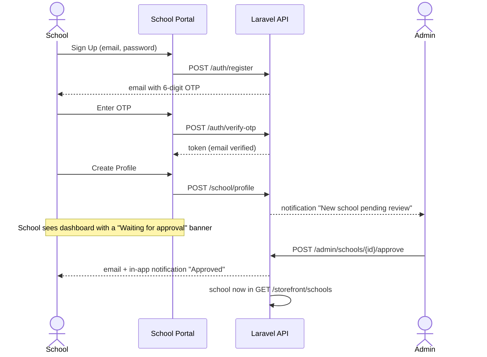
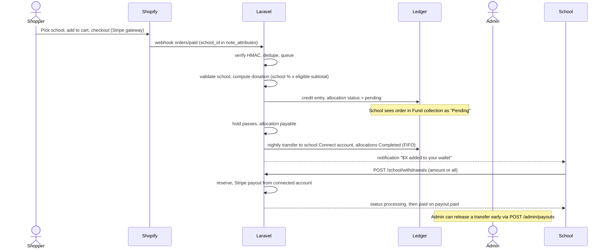
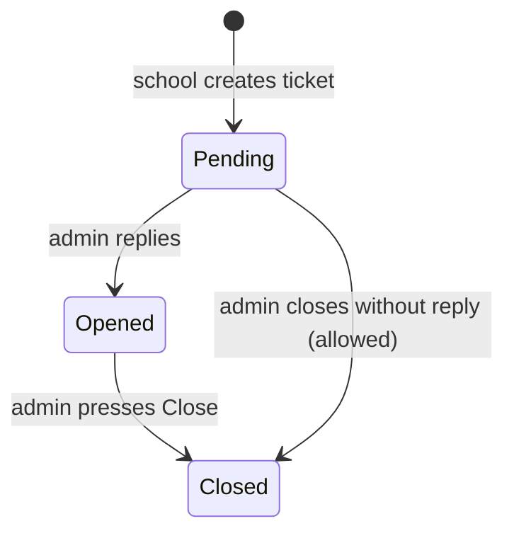

# 03 — Figma Flows & Screen Map

Source: `C:\Users\Abdullah\Downloads\School Fundraiser Store` (64 PNGs, 1920×1080 wireframes). Files with a `-1` / `-2` suffix are duplicate or variant frames. Endpoint names refer to [05 — API reference](05-api-reference.md).

## 1. Navigation

**School portal sidebar:** Dashboard · Fund collection · Profile · Support · Settings · Logout. Header: notification bell (unread count), school avatar + name + email.

**Admin portal sidebar:** Dashboard · Orders · School Management · Payout Management · Support · Settings · Logout. Same header.

## 2. Screen inventory

### 2.1 Auth (shared by both roles; one login, role decides the portal)

| Screen | Figma file(s) | Fields / actions | API |
|---|---|---|---|
| Sign Up | `Sign Up.png` | email, password, confirm password, T&C and Privacy links | `POST /auth/register` |
| Enter OTP | `Enter OTP.png`, `OTP.png`, `OTP-1.png` | 6 boxes, Verify, Resend (countdown 00:40) | `POST /auth/verify-otp`, `POST /auth/resend-otp` |
| Create Profile | `Create Profile.png` | avatar upload, school name, phone, address, state + city (autofilled from address) | `POST /school/profile` |
| Login | `Login.png`, `Login-1.png` | email, password, remember me, forgot password. Variant 2 adds Google/Apple (D6) | `POST /auth/login`, `POST /auth/social/{provider}` |
| Forgot Password | `Forgot Password.png`, `-1` | email → Submit (sends OTP) | `POST /auth/forgot-password` |
| Reset Password | `Reset Password.png`, `-1` | new + confirm → Save | `POST /auth/verify-reset-otp`, `POST /auth/reset-password` |
| Terms / Privacy (pre-login) | `Terms & Conditions*.png`, `Privacy Policy*.png` | read-only text | `GET /content/{slug}` (public) |
| Logout popup | `Logout Popup.png`, `-1` | confirm | `POST /auth/logout` |

### 2.2 School portal

| Screen | Figma file(s) | Content | API |
|---|---|---|---|
| Dashboard | `Home-1.png` | Cards: **Total Earning**, **Pending Amount**, **Completed Amount**, **Total Order**. Revenue line chart with month picker | `GET /school/dashboard`, `GET /school/dashboard/revenue?month=` |
| Fund collection | `Fund collection.png`, `… Pending.png`, `… Completed.png` | Search, tabs All/Pending/Completed, Download Reports, table: Order ID, Date & Time, Amount, Fund collection, Status | `GET /school/donations?status=&search=`, `GET /school/donations/export` |
| Profile | `Profile.png` | Avatar, name, email, phone, address, edit pencil | `GET /school/profile` |
| Edit Personal Info | `Edit Personal Info.png`, `Profile Update Popup.png` | avatar, name, email, phone, address, state, city → Update, success popup | `PUT /school/profile`, `POST /school/profile/avatar` |
| Support | `Support-1.png` | Sort-by, search, **Create Ticket**, table: Attachments, Subject, Message, Date, Status | `GET /school/tickets` |
| Create Ticket | `Create Support Ticket.png`, `Create Ticket Popup.png` | subject, message, upload images (removable thumbnails), Submit, success popup | `POST /school/tickets` (multipart) |
| Ticket details | `Support Details Pending/Opened/Closed*.png`, `Closed Ticket Popup.png` | read-only view of the ticket and the admin response | `GET /school/tickets/{id}` |
| Notifications | `Notifications-1.png` | list, per-item dismiss (×), Mark all as read | `GET /notifications`, `POST /notifications/read-all`, `DELETE /notifications/{id}` |
| Settings | `Settings-1.png` | Notifications toggle, Change Password, Privacy Policy, Terms, About Us, **Delete Account** | `PUT /me/settings` and others below |
| Change Password | `Change Password-1.png`, `Update Password Popup-1.png` | current, new, confirm → Update, success popup | `PUT /me/password` |
| Delete Account popup | `Delete Account Popup.png` | "Are you sure?" No/Yes | `DELETE /school/account` |
| About / Terms / Privacy | `About Us-1.png`, `Terms & Conditions-1/-2.png`, `Privacy Policy-1/-2.png` | read-only CMS text | `GET /content/{slug}` |

### 2.2b School portal screens missing from Figma (required by the final decisions)

| Screen | Content | API |
|---|---|---|
| **Payout account** card (Profile page or Settings) | Connect status, requirements due, bank name + last4, **Set up / Continue onboarding** button | `GET /school/stripe/status`, `POST /school/stripe/onboarding-link` |
| **Wallet** (new sidebar item, or a section of Dashboard) | Cards: In wallet, Withdrawn, Withdrawal in flight. **Withdraw** button with amount input or *Withdraw all*, confirm popup, success and failure states. Table of withdrawals and transfers | `GET /school/wallet`, `POST /school/withdrawals`, `GET /school/withdrawals`, `GET /school/transfers` |
| Pending-approval and not-onboarded banners | Explain why Withdraw is disabled | `GET /auth/me`, `GET /school/wallet` |

Brief the designer on these before the portals are built.

### 2.3 Admin portal

| Screen | Figma file(s) | Content | API |
|---|---|---|---|
| Dashboard | `Home.png` | Cards: **Total Order**, **Total Fundraising Contributions**, **Total Amount**, **Total School**. Revenue chart with month picker. Recent Orders table below | `GET /admin/dashboard`, `GET /admin/dashboard/revenue?month=` |
| Orders | `Orders.png` | Filter by date and order status, Reset, search by name or order ID. Columns: Order ID, Name, Address, Date & Time, School, Amount, Fundraising, Status (Placed / In Process / Shipped / Received) | `GET /admin/orders` |
| Order details | `Order Details.png` | Line items (name, color, size, qty, SKU, price), subtotal, shipping, total, **School** card, Order Status timeline (Placed → In Process → Shipped → Received) | `GET /admin/orders/{id}` |
| School Management | `School Management.png` | Search, tabs All/Pending/Approved/Rejected. Columns: School, Email, Phone, Date & Time, Address, Status | `GET /admin/schools` |
| School details (pending) | `School Pending Details.png` | Profile block + **Approve** / **Reject** | `POST /admin/schools/{id}/approve`, `…/reject` |
| School details (approved) | `School Approved Details.png` | Profile block, **Payout School**, **Deactivate**. Earnings cards (Total Earning, Pending, Completed, Total Order) and order table | `GET /admin/schools/{id}`, `GET /admin/schools/{id}/donations` |
| Deactivate popup | `Deactivate School Popup.png` | "Are you sure…?" No/Yes | `POST /admin/schools/{id}/deactivate` |
| Payout Management | `Payout Management.png` | Search by school, **Payout School** (override), Download Reports. Columns: Payout ID, School, Date & Time, Total Revenue, Payout Amount, Payout Method (`Stripe Connect`). Log of transfers and withdrawals | `GET /admin/payouts`, `GET /admin/payouts/export` |
| Payout School (admin override) | `Payout School.png`, `Payout School-1.png` | School dropdown, shows **Pending Amount** after choosing a school, Payout Amount input, **Transfer** = release donations to the school's Connect account now | `GET /admin/payouts/balance?school_id=`, `POST /admin/payouts` |
| Payout success popup | `Payout School Popup.png` | "Lincoln High School amount $600 has been transferred successfully." Show only once the transfer is `paid`, otherwise "Transfer initiated" | `POST /admin/payouts` response |
| Support | `Support.png` | Sort-by (status), search. Columns: Name, Email, User Type (User/School), Subject, Message, Date, Status | `GET /admin/tickets` |
| Ticket details (Pending) | `Support Details Pending.png` | ticket info, attachments, **reply composer** ("Type here…") | `POST /admin/tickets/{id}/reply` |
| Ticket details (Opened) | `Support Details Opened.png` | shows "Your Response" + **Close** button | `POST /admin/tickets/{id}/close` |
| Ticket details (Closed) | `Support Details Closed*.png` | read-only | |
| Notifications | `Notifications.png` | same as school | same |
| Settings | `Settings.png` | Notifications toggle, **Fundraising Percentage**, Change Password, Terms, Privacy, About Us | |
| Fundraising Percentage | `Fundraising Percentage.png`, `… Popup.png` | Business % + School % inputs, Save, history table (Business %, School %, Date & Time, Status Active/Closed), success popup | `GET /admin/fundraising-rates`, `POST /admin/fundraising-rates` |
| About / Terms / Privacy (editable) | `About Us.png` (pencil), `Terms & Conditions.png`, `Privacy Policy.png` | admin edits the text | `PUT /admin/content/{slug}` |
| Change Password | `Change Password.png`, `Update Password Popup.png` | | `PUT /me/password` |
| Logout popup | `Logout Popup.png` | | |

## 3. Flows

### 3.1 School onboarding

### 3.2 Forgot / reset password

`Login → Forgot Password (email) → Enter OTP → Reset Password (new, confirm) → Login`. The OTP step reuses the OTP screen. The API returns a short-lived `reset_token` after OTP verification and the reset call requires it.

### 3.3 Order to donation to transfer to withdrawal

### 3.4 Support ticket

The Figma shows one admin response per ticket (a "Your Response" block). The data model keeps a message thread so a follow-up is possible later without a migration.

### 3.5 Fundraising percentage change

Admin enters Business % and School %. The system checks they total 100, closes the current active row (`Closed`), and creates the new row as `Active` with an effective-from time. It does not rewrite past orders. Each allocation points at the rate version used.

## 4. UI states the API must support

- **Pending-approval school** sees the portal but Fund collection and payout data are empty or locked. `GET /auth/me` returns `school.status` so the UI can show the banner.
- **Empty states**: no orders, no tickets, no notifications, no payouts.
- **Loading and error** states on every table, so list endpoints must be fast and paginated.
- **Currency formatting**: the API returns `amount_minor` plus `currency`. The UI formats. The UI never does money arithmetic.
- **Dates**: ISO 8601 UTC in the API. The UI renders `Mar 16, 2026 | 12:00 PM` in the user's time zone.
- **Order ID display**: admin shows `ORD-1001` style. The school fund-collection list shows `TXN-584721` style. We store the Shopify order number and a generated `public_ref` per allocation (`TXN-…`). The two aren't the same field.
