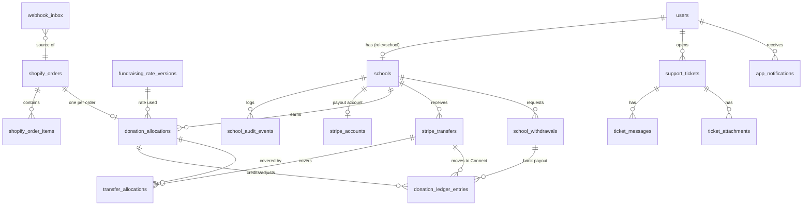

# 04 — Data Model

All money columns are `bigInteger` minor units with a `currency` char(3) next to them. All tables have `created_at` / `updated_at`. Primary keys are `bigIncrements` internally. Anything exposed to the public gets a `ulid` or a `public_ref`, so internal ids never leak.

## 1. ERD



## 2. Tables

### Identity

| Table | Columns | Notes |
|---|---|---|
| `users` | id, email (unique), password, role (`admin`/`school`), email_verified_at, notifications_enabled (bool), last_login_at, deleted_at | One row per login. Soft delete |
| `otp_codes` | id, email, purpose (`verify_email`/`reset_password`), code_hash, attempts, expires_at, consumed_at | Prune daily. Unique active code per email+purpose |
| `personal_access_tokens` | Sanctum default | abilities = role |

### Schools

| Table | Columns | Notes |
|---|---|---|
| `schools` | id, ulid, user_id (unique), name, phone, address, city, state, country (default `US`), avatar_path, status (`pending`/`approved`/`rejected`/`deactivated`), rejection_reason, approved_at, approved_by, deactivated_at, deleted_at | Index: status, name (trigram or fulltext for search) |
| `school_audit_events` | id, school_id, actor_id, action, metadata json, occurred_at | Written by activity-log or an observer |
| `stripe_accounts` | id, school_id (unique), stripe_account_id, onboarding_status, transfers_capability, payouts_enabled, requirements_due json, bank_last4, bank_name, last_synced_at | Display-safe data only. No full bank numbers |

### Rates

| Table | Columns | Notes |
|---|---|---|
| `fundraising_rate_versions` | id, version (e.g. `donation-v12`), school_bps (0–10000), business_bps (generated = 10000 − school_bps), calculation_basis (enum), included_in_price (bool, locked `true`), effective_at, closed_at, status (`active`/`closed`), created_by | Immutable. Exactly one `active` row (partial unique index). The Figma history table reads this |

`school_bps` 3000 = 30%. Validation: `school_bps + business_bps = 10000`, both ≥ 0.

### Orders and donations

| Table | Columns | Notes |
|---|---|---|
| `shopify_orders` | id, shopify_order_id (unique), order_number (`#1001` → shown as `ORD-1001`), customer_name, customer_email, shipping_address json, currency, subtotal_minor, discount_minor, shipping_minor, tax_minor, total_minor, financial_status, fulfillment_status, delivery_status, display_status (`placed`/`in_process`/`shipped`/`received`/`cancelled`/`refunded`), selected_school_id (nullable), ingestion_status (`ok`/`quarantined`), quarantine_reason, placed_at, paid_at, raw_payload json | `raw_payload` kept for audit (encrypt or prune after N days if it holds PII concerns). Customer PII is minimised |
| `shopify_order_items` | id, order_id, shopify_line_item_id, product_id, variant_id, title, variant_title, sku, quantity, unit_price_minor, discount_minor, net_eligible_minor, is_eligible | Drives "Order Details" and the donation base |
| `donation_allocations` | id, public_ref (`TXN-…`), shopify_order_id (unique), school_id, rate_version_id, rate_bps_snapshot, base_minor, amount_minor, currency, status, payable_at, created_at | **One per order.** Unique on `shopify_order_id` is the idempotency guarantee |
| `donation_ledger_entries` | id, allocation_id (nullable), school_id, type, amount_minor (signed), currency, reference_type, reference_id, note, created_at | **Append-only.** No update or delete. DB trigger or model guard enforces it |
| `stripe_transfers` | id, public_ref (`PAY-…`), school_id, amount_minor, currency, status (`pending`/`paid`/`failed`/`reversed`), stripe_transfer_id, idempotency_key (unique), initiated_by (`system`/`admin`), initiated_by_user_id, base_minor (payable balance when created, the "Total Revenue" column in Figma), failed_reason, executed_at | Platform → school Connect account. Batches the school's payable allocations. The Figma Payout Management list reads this plus `school_withdrawals` |
| `transfer_allocations` | transfer_id, allocation_id, amount_minor | FIFO coverage. An allocation is Completed when its covered sum equals its amount |
| `school_withdrawals` | id, public_ref (`WDR-…`), school_id, amount_minor, currency, status (`requested`/`processing`/`paid`/`failed`/`cancelled`), stripe_payout_id, idempotency_key (unique, from `client_request_id`), failed_reason, requested_at, paid_at | Connect balance → school bank. Never set to `paid` on API success, only on `payout.paid` |
| `stripe_payments` | id, shopify_order_id, payment_intent_id, charge_id, balance_transaction_id, amount_minor, currency, status | Maps the Shopify-created Stripe charge to the order. Required for reconciliation (see 06 §3.1) |
| `webhook_inbox` | id, provider, event_id, topic, payload_hash, payload json, status (`received`/`processed`/`failed`), error, received_at, processed_at | Unique `(provider, event_id)` |
| `reconciliation_runs` | id, provider, started_at, completed_at, result json | |

### Support, notifications, content

| Table | Columns | Notes |
|---|---|---|
| `support_tickets` | id, ulid, user_id, user_type (`school`/`user`), subject, message, status (`pending`/`opened`/`closed`), closed_at, closed_by | |
| `ticket_messages` | id, ticket_id, author_id, body, created_at | Admin replies live here |
| `ticket_attachments` | id, ticket_id, path, original_name, mime, size | Private disk |
| `app_notifications` | id, user_id, type, title, body, data json, read_at, dismissed_at, created_at | Use Laravel's `notifications` table if you prefer. Same shape |
| `content_pages` | id, slug (`about-us`/`terms`/`privacy`), title, body (HTML, sanitised), updated_by | Edited by admin (pencil icon) |

## 3. Ledger rules

Entry types and signs, per school:

| Type | Sign | When |
|---|---|---|
| `donation_credit` | + | Paid order is allocated |
| `refund_adjustment` | − | Full or partial refund (proportional to the donation base refunded) |
| `chargeback_adjustment` | − | Dispute lost |
| `transfer_to_connect` | − from platform-held balance, + to wallet | Transfer to the school's Connect account is executed. Two linked entries (`balance_bucket` = `platform` / `wallet`) |
| `transfer_reversal` | reverse of the above | Transfer failed or was reversed |
| `withdrawal_debit` | − from wallet | Withdrawal requested (reserves funds) |
| `withdrawal_reversal` | + to wallet | Withdrawal failed or cancelled |
| `manual_adjustment` | ± | Admin correction (reason required, audited) |

Derived balances (always computed from entries, never stored as a mutable counter):

- **Total Earning** = Σ credits − Σ refund and chargeback adjustments
- **Completed Amount** = Σ transfers to Connect (net of reversals). The donation has reached the school's Connect account
- **Pending Amount** = Total Earning − Completed. Of that, **payable** = past the hold period and not yet transferred
- **Wallet (available to withdraw)** = Connect balance. Our ledger's wallet bucket, cross-checked against a **fresh Stripe balance lookup** at withdrawal time (Stripe is authoritative)
- **Withdrawn** = Σ paid withdrawals. **Withdrawal in flight** = Σ requested/processing
- **Total Order** = count of allocations for the school

Cache these on a `school_balances` view or a cached query. Never trust a cached value inside a transfer or withdrawal transaction. Recompute under a row lock on the `schools` row.

## 4. State machines

**Allocation** (`donation_allocations.status`)

```text
pending ──(hold passes)──> payable ──(fully covered by transfers)──> completed
   │                          │
   └── cancelled / refunded (adjustment entries; status may be `partially_refunded`)
```

- UI badge: `pending` and `payable` → **Pending**. `completed` → **Completed**.
- `payable_at` = `paid_at` + hold days. The hourly job flips `pending` → `payable`.

**Transfer** (`stripe_transfers.status`): `pending` → `paid` (Stripe accepted) or `failed` (a `transfer_reversal` is written and the allocations go back to `payable`).

**Withdrawal** (`school_withdrawals.status`)

```text
requested ──> processing ──> paid        (payout.paid event)
                  └──────> failed        (payout.failed → withdrawal_reversal)
requested ──> cancelled
```

- `paid` only comes from the Stripe `payout.paid` event, never from the API call returning.
- Transfer succeeded but the withdrawal failed: the money stays in the wallet and the school can retry. No second transfer is ever made.

**Order display status** mapping from Shopify:

| Shopify | `display_status` |
|---|---|
| `financial_status=paid`, `fulfillment_status=null` | `placed` |
| `fulfillment_status=partial` or fulfilment `in_progress` | `in_process` |
| `fulfillment_status=fulfilled`, shipment not delivered | `shipped` |
| shipment `delivered` | `received` |
| cancelled / refunded | `cancelled` / `refunded` |

## 5. Indexes and constraints worth getting right early

- `donation_allocations (shopify_order_id)` UNIQUE.
- `webhook_inbox (provider, event_id)` UNIQUE.
- `stripe_transfers (idempotency_key)` and `school_withdrawals (idempotency_key)` UNIQUE.
- Partial unique index: at most one `requested`/`processing` withdrawal per school (blocks concurrent clicks).
- `fundraising_rate_versions`: partial unique index on `status='active'`.
- `schools (status, name)` for the public list, plus trigram/fulltext on `name` for search.
- `donation_ledger_entries (school_id, created_at)`.
- Check constraints: `amount_minor` ≥ 0 on allocations and payouts. Ledger is signed.
- Foreign keys everywhere, `restrictOnDelete` for ledger-related tables.
