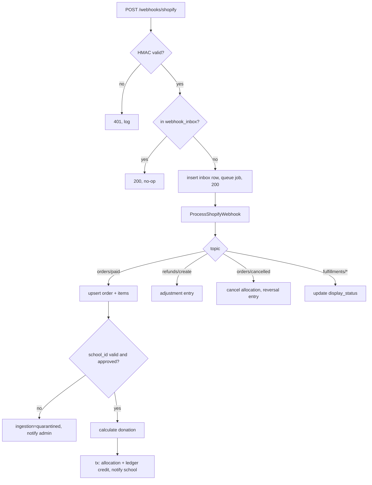
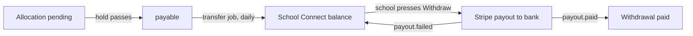

# 06 — Shopify & Stripe Integration

This is the part of the build with the most risk. It restates the two plan files as concrete Laravel work and adds the gates that must pass first.

## 1. Division of responsibility

| System | Owns | Never does |
|---|---|---|
| Shopify theme | School selector, disclosure text, `school_id` cart attribute | Money math, secrets, Stripe |
| Laravel | Approved schools, rate, order ingestion, ledger, payouts | Checkout, product catalogue |
| Stripe | Charges (via Shopify gateway), transfers, payouts | School approval, donation rules |

## 2. Shopify side

### 2.1 Setup

- Create a **custom app** in the store admin. Scopes: `read_orders`, `read_fulfillments`, `read_products` (and `read_all_orders` if orders older than 60 days are needed for reconciliation). Store the Admin API token and webhook secret in env.
- Register webhooks (via Admin API at deploy time, or declared in the app config): `orders/create`, `orders/paid`, `orders/updated`, `orders/cancelled`, `refunds/create`, `fulfillments/create`, `fulfillments/update`, `fulfillment_events/create`. Pin the API version in config.
- Theme work is workstream C and follows `shopify_grow_school_selector_plan.md`. This backend only has to supply `/storefront/schools`, `/storefront/schools/{id}` and `/storefront/donation-settings`, and then read the attribute back off the order.

### 2.2 Cart attribute contract

The theme writes cart attributes with `/cart/update.js`:

```json
{ "attributes": { "school_id": "01HV…ULID", "school_name": "Lincoln High School", "donation_settings_version": "donation-v12" } }
```

On the order they arrive as `note_attributes: [{ name, value }]`. **Only `school_id` is trusted.** `school_name` and the version are for display and audit. The percentage is never read from the order.

### 2.3 Ingestion pipeline



Rules:

- Verify HMAC against the **raw body** with `hash_equals`. Use `$request->getContent()`. Do not re-encode the JSON.
- Dedupe on `X-Shopify-Event-Id` (or `X-Shopify-Webhook-Id`). Even if the header is missing, the allocation's unique `shopify_order_id` stops duplicates.
- Handle out-of-order delivery. An `orders/updated` can arrive before `orders/paid`, so every handler is an upsert keyed on `shopify_order_id`.
- Allocate only when `financial_status` is `paid` (or `partially_refunded` with a positive net). `orders/create` alone never creates a donation.
- If the payload is ambiguous (missing discount allocations, refund breakdown), re-fetch the order from the Admin API before calculating.
- A school that was approved when selected but is `deactivated` at payment time: **quarantine**, don't guess. Admin can resolve with `assign-school`.

### 2.4 Donation calculation

```text
eligible_base = Σ over eligible line items of
                  (unit_price × quantity) − discount allocated to that line
exclude: shipping, tax, gift-card payment amounts, ineligible products
amount = round_half_up(eligible_base × school_bps / 10000)
```

- `school_bps` comes from the **active `fundraising_rate_versions` row at `paid_at`**. Snapshot it onto the allocation (`rate_bps_snapshot`, `rate_version_id`).
- Rounded once per order, in integer minor units.
- Refund: reduce `base` by the refunded eligible line amount, recompute the donation, and write a `refund_adjustment` for the difference. Never edit the original credit.
- Cover this with table-driven unit tests. Include discount codes, quantity, mixed eligibility, 100% discount (donation 0), and rounding edge cases such as `$0.05 × 30%`.

### 2.5 Mandatory selection (Grow limitation)

The theme can block the checkout button, but Buy Now, Shop Pay and direct checkout links bypass it. A validation app or Shopify Plus is the only way to enforce it. This is a **release decision, not a backend task.** The backend's safety net is quarantine: a paid order with no valid school never silently gets credited, and the admin sees it under Orders → Needs attention.

## 3. Stripe side

### 3.1 Phase 0 feasibility gate (before any transfer code)

Run these on the staging store with a small live-mode or test-mode purchase:

1. Does the Shopify-created Stripe charge exist in the **same Stripe account** that has Connect enabled? Can you `retrieve` it with the platform key?
2. Can you map charge ↔ Shopify order reliably (payment reference or metadata, not amount or email)?
3. Is the platform's balance available for transfers, given the merchant payout schedule?
4. Which Connect account type fits US schools (Express is the usual choice) and what verification do schools face?
5. Can payouts for connected accounts be controlled, or do they follow Stripe's automatic schedule?
6. Any legal or charity-handling constraints on holding and moving donated funds?

**Stripe Connect is the decided payout mechanism.** A "no" or "unclear" answer to any of these means the payout design must be reworked with the client before Phase 3 starts. Do not build a workaround silently.

### 3.2 Transfer policy: Policy A (decided)

Donations move to the school's Connect balance automatically. The school then withdraws that balance to its bank.



**Transfer engine** (`donations:transfer-payable`, daily, plus the admin override):

1. Select schools with payable allocations whose Stripe account has transfers enabled.
2. Per school, in one transaction with a row lock: sum payable, create a `stripe_transfers` row (`idempotency_key = school_id + date + sequence`), link `transfer_allocations` (FIFO), and write `transfer_to_connect` ledger entries.
3. Queued `ExecuteTransfer` calls `Transfer::create` with `destination = stripe_account_id`, `transfer_group = public_ref`, and the idempotency key.
4. Use `source_transaction` only when the transfer maps to one eligible platform charge. Batched transfers draw on the platform available balance, so check that balance and the platform payout schedule first. The platform's own automatic payouts to the merchant bank may drain the funds needed for Connect transfers.
5. `failed` → `transfer_reversal` entries, allocations back to `payable`, admin notified.

Schools that haven't finished Connect onboarding keep accruing. Their donations stay `payable` and transfer as soon as the account is enabled.

The admin **Payout School** screen from the Figma is an override. It runs the same engine for one school ahead of schedule, with a reason and an audit entry.

Stripe fees, Connect fees and refund treatment need a written allocation rule before launch (who bears processing fees on donated amounts). Default: the donation is computed gross, and fees are absorbed by the business.

### 3.3 Connect onboarding

1. School is `approved`, so it sees the **Payout account** card on Profile and the Wallet screen.
2. `POST /school/stripe/onboarding-link` → create the connected account if missing (Express, the school's country) → create an `account_link` (short-lived) → return the URL.
3. `account.updated` webhook → update `stripe_accounts` (transfers capability, `payouts_enabled`, `requirements_due`, bank name and last4). Notify the school when requirements are due.
4. Bank details are entered only in the Stripe-hosted flow. We store the account id and status flags.
5. Admin Payout School screen disables Transfer for a school whose account isn't ready, with the reason.

### 3.4 School withdrawals

Endpoint rules are in 05 (`POST /school/withdrawals`). Behaviour:

- School and Stripe account are resolved server-side from the token. The request can't name an account.
- Fresh Stripe balance lookup by currency, payout minimum, and `payouts_enabled` are checked before reserving.
- Reserve in the DB (`withdrawal_debit`), then call the Payouts API **in the connected-account context** with an `Idempotency-Key`. Store the payout id. Status is `processing`.
- `payout.paid` (Connect webhook, routed by `event.account`) → `paid`. `payout.failed` or a cancellation → `withdrawal_reversal` and notify the school.
- If the account's payout schedule is automatic and API-created payouts aren't allowed, the Wallet screen shows balance and schedule only, with the Withdraw button disabled. Never promise instant withdrawal.

### 3.5 Idempotency and concurrency

- Transfer keys are deterministic per school and run. Withdrawal keys come from `client_request_id`. Both are unique in the DB and sent to Stripe.
- Double-click on Withdraw returns the first withdrawal. A partial unique index allows only one in-flight withdrawal per school.
- Admin override and the nightly job at the same time: both lock the `schools` row, and the second sees the reduced payable balance.
- Transfer succeeds but a later step fails: status stays `pending`. The sync job reconciles from Stripe and never creates a second transfer.
- Transfer succeeds but the payout fails: distinct statuses, no duplicate transfer, funds remain in the wallet.

## 4. Failure scenarios and the planned behaviour

| Scenario | Behaviour |
|---|---|
| Duplicate or replayed webhook | Inbox unique constraint. No-op |
| Webhook lost | Daily reconciliation pulls orders for the last N days and processes missing ones |
| Order paid without a school | Quarantine, admin notification, `assign-school` resolution |
| School deactivated between selection and payment | Quarantine |
| API down when the shopper picks a school | Theme shows an error, no default school, checkout blocked in the theme |
| Partial refund | Proportional `refund_adjustment` |
| Refund after transfer or withdrawal | Negative ledger entry. Consider a Stripe transfer reversal only if funds are still in the wallet. Otherwise the balance goes negative and is offset against future donations, shown to the admin. No bank-paid amount is subtracted without a recorded debt |
| Chargeback | `chargeback_adjustment`, flag on the order |
| Rate changed mid-cart | Rate read at payment time. The theme refreshes the estimate before checkout. Final value is always the server's |
| Transfer fails (insufficient platform balance) | Transfer `failed`, reversal entry, allocations back to `payable`, admin sees the reason. The nightly job retries |
| Withdrawal fails at the bank | `payout.failed` → `withdrawal_reversal`, funds back in the wallet, school notified, can retry |
| School not onboarded or requirements outstanding | Donations accrue as `payable`, Withdraw disabled with the reason |
| Currency mismatch | Reject the payout (422), alert. v1 is single-currency |

## 5. Reconciliation (admin must be able to trust the numbers)

Daily job writes a `reconciliation_runs` row and flags any difference between:

- Σ allocations vs Σ ledger credits (must match exactly)
- Σ transfers vs Σ `transfer_to_connect` entries, and Σ withdrawals vs Σ `withdrawal_debit` entries
- Our wallet bucket vs the live Stripe connected-account balance
- Shopify paid-order totals vs our `shopify_orders`
- Stripe transfers and payouts vs `stripe_transfers` and `school_withdrawals`

Surface failures as an admin notification. The Payout Management "Download Reports" CSV includes the totals needed for a manual check.
